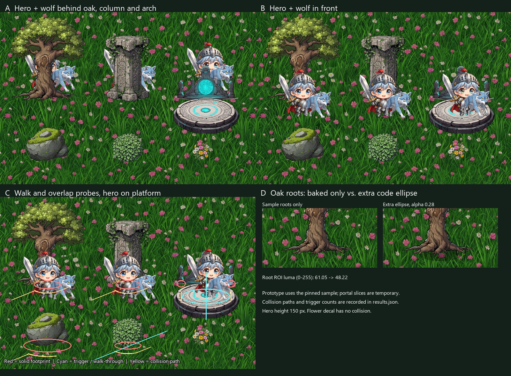

# Hợp đồng lớp vẽ và va chạm cho prop Rừng Xanh

**Đề xuất để Luna duyệt.** Engine kiểm tra tại [main 41417be](https://github.com/tuandd1985-ship-it/fantasy-huyen-thoai-luc-dia-/tree/41417beda2fc1c9a66f10b38ea0b6c091e63b9ae). Prop và tile đối chiếu byte với bản [a7ce924](https://github.com/tuandd1985-ship-it/fantasy-huyen-thoai-luc-dia-/tree/a7ce924/art-tests/rung-xanh-map-sample). Scene dùng mẫu tĩnh và mã thử độc lập.

**Kết luận.** Engine đã hỗ trợ lớp nền và lớp Y-sort chung. Cổng đúng thiết kế cần thêm adapter vẽ prop theo dữ liệu, footprint ellipse/rect và trigger độc lập. Bệ và vòm xuất thành hai ảnh chung group và điểm gốc thế giới. Hai chân vòm chặn đường, phần giữa cho đi qua.

[Xem ảnh scene A–D](engine-prop-scene/scene.jpg) · [Kết quả và đường đi](engine-prop-scene/results.json) · [Mã tái lập](engine-prop-scene/scene.py)



## 1. Engine hiện hỗ trợ gì

| Hạng mục | Bằng chứng và kết luận |
|---|---|
| Nền và bệ/decal | `draw()` dịch theo camera, gọi `Sprites.background()`, rồi vùng báo đòn và quầng hero. Cầu và cổng hiện tại được vẽ trong background. Có sẵn điểm chèn decal/bệ, cần thêm đường nạp ảnh theo schema. [Nền và cổng](https://github.com/tuandd1985-ship-it/fantasy-huyen-thoai-luc-dia-/blob/41417be/index.html#L1707-L1746) |
| Y-sort thực thể và prop | Vật cản, đồ rơi, quái và hero vào cùng danh sách, sắp theo Y chân tăng dần. Vật thể vẽ sau sẽ che vật thể vẽ trước tại vùng ảnh giao nhau. Sau đó là tên/thanh máu, đạn và hiệu ứng. Harness chạy đoạn `draw()` trích nguyên tới hết danh sách vẽ với context ghi lời gọi. Kết quả `background → hero → obstacle → monster` ứng với Y = 260, 280, 295. [Vòng vẽ](https://github.com/tuandd1985-ship-it/fantasy-huyen-thoai-luc-dia-/blob/41417be/index.html#L3068-L3128) |
| Phần sau/trước của cùng prop | Thiếu lớp dữ liệu cho nhiều mảnh, chưa có group ID, anchor chung hoặc foreground dành cho prop. Adapter có thể đăng ký bệ ở ground và vòm ở danh sách sorted. Prop khác có phần trước/sau cần che tùy vị trí nên đưa từng mảnh vào sorted với `sortY` riêng. Dành foreground cố định cho phần luôn che cảnh, như tán sát camera. |
| Hình va chạm | `Collision.resolve()` dùng khoảng cách tới tâm và bán kính vật cản cộng bán kính thực thể. `pointBlocked()` dùng bán kính riêng cho đạn. `waterRects` là logic sông riêng. Harness chạy `Collision` trích nguyên và xác nhận thử hai trụ tròn chừa lối giữa được, nhưng vòng tròn bán kính 42 chặn ở Y lệch 38 trong khi ellipse 84×26 với chân 14 px sẽ cho qua. [Va chạm hiện tại](https://github.com/tuandd1985-ship-it/fantasy-huyen-thoai-luc-dia-/blob/41417be/index.html#L1571-L1626) |
| Tương tác cổng | Cổng vào/ra hiện là hình nền, có điểm spawn/minimap. Chuyển màn đi qua `msgBtn` và `startStage()`. Chưa có đường xử lý overlap ở giữa bệ. [Spawn](https://github.com/tuandd1985-ship-it/fantasy-huyen-thoai-luc-dia-/blob/41417be/index.html#L2608-L2622) · [Chuyển màn](https://github.com/tuandd1985-ship-it/fantasy-huyen-thoai-luc-dia-/blob/41417be/index.html#L4233-L4237) |

SPEC §6 yêu cầu vật cản thật, trượt và đạn bị chặn. §6c yêu cầu đúng chiều sâu ở góc nhìn 2.5D và di chuyển 8 hướng. ART_DIRECTION yêu cầu lớp xa/gần và bóng vật thể. [SPEC](../../docs/SPEC.md) · [ART_DIRECTION](../../docs/ART_DIRECTION.md)

## 2. Schema tối thiểu đề xuất

Tất cả số đo tính theo pixel thế giới ở kích thước hiển thị 1×. Placement có `x,y` làm anchor chung của group. Mỗi ảnh có `anchorX,anchorY` đo từ góc trên trái trên ảnh **đã scale**. Vẽ tại `(x-anchorX,y-anchorY)`; anchor ảnh có thể nằm ngoài canvas sau khi cắt. `sortY` là độ lệch Y so với anchor thế giới; so sánh `y+sortY` với Y chân của hero/quái. Với cùng Y, sắp ổn định theo thứ tự khai báo hoặc ID để tránh nhấp nháy.

```ts
type Shape =
  | { type: 'none' }
  | { type: 'ellipse' | 'rect'; offsetX: number; offsetY: number; width: number; height: number }

type PropPart = {
  id: string; groupId: string; image: string;
  displayWidth: number; displayHeight: number;
  anchorX: number; anchorY: number; sortY: number;
  layer: 'ground' | 'sorted' | 'foreground';
  collision: Shape[]; // [{type:'none'}] hoặc một/nhiều footprint
  interaction: Shape;
  shadow: { type: 'none' | 'baked' } |
          { type: 'code-ellipse'; offsetX: number; offsetY: number;
            width: number; height: number; opacity: number };
}
```

Offset hình tính từ anchor group; ellipse và rect đều dùng **tâm** và kích thước toàn phần. Collider hình ảnh và trigger là dữ liệu riêng. Bbox ảnh chỉ phục vụ render/culling; thay vùng culling cố định bằng bounds hiển thị của prop cao. Dữ liệu collision/interaction đăng ký một lần theo part sở hữu, tránh nhân đôi khi group có nhiều ảnh.

| Part, cùng group `forest-portal-01` | Layer / Y | Collision | Interaction |
|---|---|---|---|
| Bệ | ground | none | ellipse 150×48, tâm (0,+40) trong scene |
| Vòm | sorted, `sortY=0` tại đường hai chân | Hai ellipse 28×22, tâm (−78,0)/(+78,0) ở tỷ lệ thử | none |

Các offset là điểm khởi đầu; Luna chốt lại theo ảnh tách cuối. Với hình hiện có, scene cắt thử quanh hàng 485/994, giữ căn chỉnh hai phần. Phần ảnh chính thức cần tách tại biên vòm/bệ, xuất anchor đăng ký hoặc hai canvas cùng đăng ký, giữ khe đi giữa và phần alpha trong suốt đúng thiết kế.

**Thay đổi nhỏ theo phạm vi.** Giữ Y-sort và camera, thêm ba pass (ground → sorted → foreground) tại các điểm vẽ hiện hành. Giữ obstacles hình tròn cũ tương thích, thêm truy vấn footprint ellipse/rect cho di chuyển và projectile. Cho overlap trên chân hero sau khi resolve va chạm, phát sự kiện `enter/exit` theo group; đề xuất hiển thị nút tương tác khi đứng trên bệ, Luna chốt action. Không gắn thay màn tự động vào vòng lặp mỗi frame. Giữ hành vi cổng cũ đến khi Luna duyệt và kiểm thử cổng mới.

## 3. Scene và số đo

Pillow ghép ảnh theo pass đề xuất, đóng băng trước/sau để đối chiếu trực quan. Node chạy đoạn Y-sort và Collision hiện tại như trên. Phép thử di chuyển dùng tâm chân bán kính 14, mở rộng hai trục ellipse để xấp xỉ footprint và chia bước tối đa 3 px. Đây là fixture hình học với mỗi vật cản độc lập; rect, projectile, AUTO, tốc độ lao, dt xấu và va chạm nhiều prop sát nhau cần test khi tích hợp.

| Probe | Kết quả |
|---|---|
| Hero 150 px và sói trước/sau sồi, cột, vòm | Cả hai đổi thứ tự đúng trong ảnh A/B và danh sách Y. Cả hai vẽ trên bệ khi đứng phía trước. |
| Sồi 84×26, đá 150×42, cột 76×28 | Ba đường đi chéo đều có tiếp xúc và trượt tiếp qua X tâm. Sồi 53, đá 73, cột 51 lần hiệu chỉnh ở cấp substep, không có substep kết thúc xuyên footprint đã nới. |
| Bụi 84×24 / none | Cùng đầu vào: ellipse hiệu chỉnh 51 lần, đích (471.40,471.76); none hiệu chỉnh 0, đích (523,420). Khuyến nghị `none` cho bụi trang trí để không chặn lối; dùng solid cho bụi được thiết kế thành vật cản đọc rõ. |
| Khóm hoa | ground decal, không có collider. QC gốc vẫn trượt ΔE 15,8 so với ngưỡng 12; kết quả này độc lập với va chạm. |
| Cổng | Hero đi từ (645,385) đến (645,241), 0 va chạm, 1 lần vào và 1 lần rời trigger. Hai đường vào chân vòm đều bị chặn tại Y=297 và không kích hoạt overlap trong fixture. |
| Bóng sồi | So cùng tile và vị trí. Ellipse đen 120×36, alpha 0,28 làm luma trung bình vùng gốc 84×28 giảm từ **61,05 xuống 48,22/255**, khoảng **21%**. Vùng tối mở rộng dưới rễ. Đề xuất `baked` cho ảnh mẫu hiện tại, tắt ellipse thêm. Nếu bộ cuối xuất bóng riêng hoặc bỏ bóng khỏi bitmap, có thể duyệt lại `code-ellipse`. |

REPORT và QC gốc ghi 5/6 prop đạt toàn bộ QC, khóm hoa trượt chỉ số viền, tile gốc quá rực so với ART_DIRECTION. Scene dùng đúng tile mẫu và phủ một lớp màu tối để đọc vị trí; không coi đây là duyệt tile. [REPORT](../../art-tests/rung-xanh-map-sample/REPORT.md) · [QC](../../art-tests/rung-xanh-map-sample/qc.json)

Tái lập từ gốc repo bằng Python có Pillow, Git và Node sẵn trong PATH:

```sh
python docs/art/engine-prop-scene/scene.py
```

Luna có thể duyệt ngay cách cắt **bệ + vòm giữ anchor chung** và footprint độc lập. Trước tích hợp, cần chạy lại các probe bằng game render thật trên vị trí đặt cổng đã chốt, chừa đủ chỗ hai phía trong giới hạn map, kiểm tra hero/quái/đạn ở biên camera và kích hoạt đúng một lần trên mỗi thao tác.
